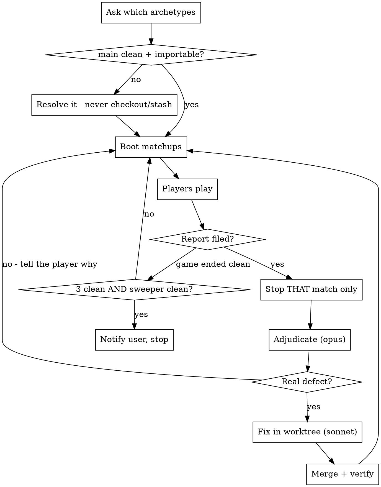

# Playtest Loop

## Overview

Two AI agents play real Modern decks against each other through the API. When
one of them proves the engine broke a rule, that match stops, the defect is
adjudicated against the Comprehensive Rules, fixed globally in an isolated
worktree, merged, and the loop restarts.

**The goal is a complete MTG rules engine for the Modern format** — one that can
model any legal game. Not a card database with helpers.

**Every ability must be parsed from oracle text.** MTG uses a strict templating
language, so this is tractable. A card-name-to-behaviour dictionary is banned:
it cannot generalise to cards nobody has added yet, which is the entire point.
A handful of cards genuinely resist templating (Emrakul, the Promised End's
"control your opponent's next turn" is the canonical example); those are
allowed as documented special exceptions, nothing else is.

**REQUIRED BACKGROUND:** Read `CLAUDE.md` at the repo root before running this
loop. It carries the two rules that outrank everything here: never state a CR
number from memory, and never mock.

## Reporting discipline: say almost nothing

The orchestrator's user-facing output is not a status feed. Working silently
while dispatching agents is the expected default, not a lapse.

**Report only these:**

- a game that ran to a **winner**, and whether it was clean
- the **goal condition** or the **context ceiling** firing
- a **decision that is genuinely the user's** (ask it, do not narrate around it)
- something that **changes what the user believes** — a policy contradiction, a
  defect the loop itself caused, a correction to something already said

**Never report:** which agents were dispatched, merges that went as predicted,
per-wave sweeper deltas, adjudication summaries, trap lists, what is in flight,
or what happens next. All of that is visible in the tooling and is noise here.

One or two lines is a normal turn. Zero lines is a normal turn. A table of
cumulative metrics is not, unless a game just ended or the loop is stopping.

Numbers still get **verified** exactly as rigorously as before — the discipline
is on what gets *said*, never on what gets *checked*. Silent does not mean
unverified.

## Termination and notification

Run until **either**:

1. **Goal reached** — ALL of:
   - three consecutive matchups complete with zero engine reports,
   - those three use **three different deck pairings**, each drawn at random
     (see "Randomize the matchups"), not the same pair three times,
   - each of the three ran to a **winner** (a game abandoned early does not
     count),
   - `scripts/sweep_pool.py` reports **zero silent cards**,
   - the **notice** count has not grown since the previous iteration (see
     "Fail-closed is a stopgap" below).
2. **Context ceiling** — the orchestrator passes **70% context used**.

**In both cases, stop and notify the user**, and write a handoff (`handoff`
skill) saying which condition fired.

**You cannot measure your own context directly.** Estimate from what you have
consumed — number of agent dispatches, size of results read — and err on the
side of stopping early. Stopping at 60% with a good handoff beats running to 85%
and handing over nothing.

### The goal condition is gameable — do not game it

Each of these technically satisfies a clause while defeating the intent. They
are forbidden:

- **Replaying an easy pairing.** Three clean games with the two simplest decks
  proves the engine handles two simple decks. Hence the distinct-pairings rule,
  and hence the random draw: a pairing you chose is a pairing you are
  comfortable with, and comfort is what stops the games finding anything.
- **Redrawing until the matchup looks convenient.** The draw stands. Rerolling
  because a mirror came up, or because a deck is awkward to pilot, is picking
  by hand with extra steps. The only legitimate redraw is a pairing the API
  genuinely cannot run yet — and that gets fixed and recorded, not skipped.
- **Passive play.** A player that avoids ambiguous lines files no reports. Player
  prompts must require *actively exercising* the deck's mechanics — attack,
  block, use activated abilities, resolve triggers — not merely playing legally.
- **Grinding the sweeper separately.** Driving the silent count to zero with
  single-card parser patches that no game ever exercises satisfies the number
  and not the goal. Every parser needs a scenario test, and the games are what
  prove it matters.
- **Declaring anything unparseable.** See below.

### Fail-closed is a stopgap, not a solution

"Fail closed with a notice" is the correct behaviour for something you *cannot*
read. It is **not** an acceptable way to dispose of something you do not feel
like implementing — that converts a silent card into a noisy one and calls it
progress.

Track the notice count alongside the silent count. **Silent falling while
notice climbs is not progress**, and the goal condition forbids finishing in
that state. If you mark something fail-closed, say in your report why it is
genuinely unreadable rather than merely hard.

## The loop



**Every box except "Players play" and the two agent-dispatch steps is you, the
orchestrator.** Booting, log-reading, report triage, merging, verifying and
restarting all consume your own context — which is why the 70% ceiling exists
and why false reports are expensive even when they cost no fix.

**Work the backlog while games run.** A matchup takes tens of minutes of agent
wall-clock. Spend it dispatching fix waves against the sweeper's silent list, in
worktrees. Just do not *merge* any of them until every game is stopped.

### 1. Randomize the matchups

**Matchups are drawn at random, every boot.** The human may still name a pairing
and that overrides the draw; absent an instruction, do not pick by taste, by
what is easiest to pilot, or by what worked last time. Draw them.

```sh
ls ../magic-cards-model-api/decks/ | shuf | head -N     # N seats' worth
```

**Mirrors are in the pool and must actually come up.** Draw each seat's deck
independently, with replacement, so a deck can face itself. A mirror is not a
wasted game: both seats race the same clock, fight over the same stack
interactions, and hit symmetric triggers and legend-rule collisions that no
cross-archetype game reaches.

The point of randomizing is that **different pairings walk different code
paths**. A control deck against a combo deck exercises counterspells, stack
depth, and end-step timing; two aggro decks exercise combat math, blocks, and
first strike; a mirror exercises simultaneous identical triggers and the same
card on both sides of a targeting decision. Hand-picked pairings quietly test
the same subset of the engine over and over, and the games stop finding things.

Record the draw (deck for each seat, and the seed) with the matchup, so a
report can be re-run. If a drawn pairing is genuinely unplayable right now —
a deck whose core mechanic the API cannot yet reach from a seat — say so, fix
that, and redraw rather than substituting a convenient pairing silently.

**Check what already exists first** — `ls ../magic-cards-model-api/decks/` — and
draw from those, rather than re-fetching lists that are already on disk. Open one
to see the format before writing a new one.

If the human names an archetype with no list on disk, pull a **real tournament
list** with `statistics_decks(format="modern", date_from=..., include_cards="full")`.
Never assemble one from `statistics_archetypes` core_cards: those are averages
across a window and can predate a ban. Verify legality with
`resolve_cards(names=[...], format="modern", fields="legality")` and record the
pilot and tournament date in the file.

A random draw is the default even when running autonomously. The one allowed
thumb on the scale: if several decks are still untried against each other, or a
deck's mechanic has never been exercised in a game, weight the draw toward it
and say so — that is broadening coverage, not picking a favourite.

### 2. Boot the matchups

**Before booting: `main` must be clean, committed, and importable.** Verify:

```bash
git status --short          # empty
uv run python -c "import magic_cards_model.models.game"
```

**If `main` is dirty**, do not reach for `checkout`/`restore`/`stash` — they are
banned here and one of them already destroyed a day and a half of work. Instead:
inspect the diff, and either commit it (if it is finished work someone left) or
`cp` it aside and commit, so nothing is discarded. If it will not import, the
likely cause is an interrupted merge — resolve it before anything else, since a
non-importing tree breaks every player command in every match.

**Seeds:** any integer; record it. The same seed with the same decks reproduces
the same opening, which is what you want when re-testing a fix against the game
that found it.

Then boot one server holding every matchup:

```bash
cd ../magic-cards-model-api
lsof -ti :8000 -sTCP:LISTEN | xargs kill    # the flag matters - see Traps
.venv/bin/python3 -m magic_cards_model_api.serve \
  --match alice=decks/X.txt,bob=decks/Y.txt,seed=NNN \
  --match carol=decks/P.txt,dave=decks/Q.txt,seed=NNN \
  --port 8000 > /tmp/game-server.log 2>&1 &
```

Seat uids print in the boot block. Give each player agent **one** uid and its
`--game` id.

### 3. Players play

Dispatch one agent per seat with the **Agent tool**, `subagent_type:
"general-purpose"`, `model: "sonnet"`, `run_in_background: true`, in a single
message so they start together. **No worktree** — players only talk to the
server over the CLI; they never touch the repo.

`model: "haiku"` was tried and all six seats abandoned their game by turn 2,
inventing limits that do not exist, and several misused `advance` and then
reported the CLI as broken. False signal is worse than no signal in a loop that
runs on player reports. **Use sonnet.** Haiku is fine for log summarisation.

See Player prompts below for what each prompt must contain.

A player files a report only when it can prove the engine broke a rule, with a
CR number looked up **that session** via `knowledge_search(q="...", type="rules")`.
Reports carry what happened, the log seq numbers, and the ruling — **never code
suggestions**.

### 4. A report stops only its own match

Other matchups keep playing. Stop the reporting seat with `TaskStop`.

**Verify the report against the log yourself before dispatching anyone** —
roughly half of all reports have had a wrong cause attached to a real symptom,
and some were entirely the player's mistake. Read the raw log:

```bash
curl -s http://127.0.0.1:8000/api/games/<id>/log   # JSON key is "log"
```

Look for `resolved: <name>, changed: false` — that is the engine's own marker
for an effect it could not execute. Check whether a `decide` entry exists near
the reported seq, and whether a `decision_timeout` fired: a player that let a
decision default caused its own problem.

**If the report is wrong**, do not silently move on. Relaunch that seat with a
prompt that states plainly what it got wrong and why, and adds the mistaken
belief to its do-not-report list. A player that is never corrected files the
same wrong report again.

### 5. Adjudicate

**Model: opus** (fable if genuinely hard). Read-only. It establishes the ruling
from the CR, finds the root cause, scopes how many cards share the mechanic,
and lists the ways a naive fix would produce a wrong-but-plausible board.

Tell it your own theory **and tell it not to trust you**. Adjudicators have
refuted the orchestrator's theory more than once, and been right.

### 6. Fix

Dispatch with the **Agent tool**, `model: "sonnet"`, **`isolation: "worktree"`,
always**. The fix must:

- **Include a scenario test that faithfully reproduces the reported case** —
  same cards, same board, same sequence — on top of whatever else it writes.
- **Prove that test catches the bug**: revert the fix, confirm the test fails,
  restore it. A test that passes both ways protects nothing.
- Be **global**: parse the mechanic off oracle text so every card sharing it
  works, not just the reported card.
- **Fail closed with a notice** for anything it cannot fully read — and justify
  each one as genuinely unreadable rather than merely hard.
- **Commit inside its worktree** before finishing, and report `git log --oneline -1`.

Then dispatch a **sonnet reviewer** (read-only, no worktree) told to attack the
fix rather than confirm it, with the specific failure modes the adjudicator
listed. Reviewers here have found real bugs the implementer missed — and have
also produced confident wrong findings, so verify a finding before acting on it.

### 7. Merge and verify

Merge only when no game is running (see Traps). Then verify with **three**
checks, because the first two return green on an empty merge:

```bash
git merge-base --is-ancestor <branch> HEAD && echo IN
ls tests/scenarios/test_<name_the_fix_agent_reported>.py   # it must exist
mise run test
cd ../magic-cards-model-api && uv run pytest    # the cross-repo contract
```

**The fourth check is not optional.** The engine's own suite cannot see a
cross-repo contract break. When an engine wave adds a `DecisionKind`, the API's
`decide` endpoint cannot answer it, a live seat's every answer is refused, and
the game *hangs* — every seat in that match, not just the card. That killed a
real game (`choose_a_quality`, from a merge verified green on the engine suite
alone). The API's `test_every_decision_kind_is_answerable_or_served_elsewhere`
catches it at merge time instead of turn 3, and it has already caught a second
one (`pay_mana`) — but only if you run it.

**"The total must move" means the passed count rises by at least the number of
tests the fix agent said it added.** Note the count before merging and compare.
If the count is unchanged, the merge was a no-op — the agent left its work
uncommitted, and the branch tip never moved. That has happened twice.

If the suite goes red, the two waves interacted; fix it before booting games,
and judge whether the newly-failing test was asserting correct behaviour or
encoding a defect.

### 8. Restart

Restart the server so it picks up the new engine code, and go to step 2.

## Player prompts — required elements

Every one of these was added after a player failed without it.

- **In a mirror, say so in both prompts.** Two seats on the same decklist will
  otherwise each assume a card on the board is theirs. Tell each seat its own
  name, that the opponent is on the identical list, and that it must read
  `controller` on every board object rather than inferring ownership from the
  card's name. Mirrors are also where the legend rule and identical
  simultaneous triggers actually get exercised, so the prompts should push
  toward those lines rather than around them.

- **One uid and one `--game`, on every command.** With several games on one
  server, `seatkit` defaults to `games[0]` and other seats are rejected with
  "that uid is no seat in this game".
- **An explicit stop condition:** play until `state` shows a `winner`, or until
  you file a report. Stopping for any other reason is not allowed, and a
  partially played game is worthless.
- **`advance` is ONLY for untap and cleanup.** In a main phase, `play-land` /
  `cast` then `pass`. Using `advance` in a main phase skips your own turn.
- **If `pass` is refused with "you do not have priority", wait again — never
  `advance`.** That strands the stack.
- **Always bound the wait: `wait --max-seconds 30`, called in a loop.** A bare
  `wait` blocks indefinitely, the shell backgrounds it, and the player's turn
  ends having done nothing. Three seats died this way in one session, each
  reporting some variant of "I'll wait for the background command" as its final
  answer. A bounded wait returns promptly and the player calls it again.
- **Decisions:** a pending decision freezes the game; answering it is the only
  legal move; a command may return early specifically to hand you one. An
  unanswered decision times out to a default and silently wastes the card.
- **A do-not-report list** of currently-known gaps, so reports aren't wasted.
  **Generate it, never hand-curate it:**

  ```sh
  uv run python scripts/known_gaps.py     # --detail for each gap's note
  ```

  It reads the "Not modelled" table in `docs/engine-coverage.md`, the single
  source of truth. Hand-curating this list went stale **three times in one
  session** — Utopia Sprawl's colour choice, Ocelot Pride's ascend, and
  Mobilize's tokens each cost a player its whole game on an already-documented
  gap. Paste the generated list, then add only the waves in flight right now.

  A gap the doc does not record is a gap players keep re-reporting, so when a
  wave leaves something deliberately unbuilt, the doc entry is part of the wave,
  not paperwork after it.

- **"Resolves and does nothing" is NOT reportable** — pass
  `scripts/known_gaps.py --silent` and paste that list too. The sweeper already
  enumerates every silent card, and they are worked in batches; a player that
  spends its one report on one spends it on something already counted.

  **What a game finds that a sweeper never can is a card that does the WRONG
  thing.** Say so explicitly and give examples: an effect with the wrong
  target/amount/player/zone, a trigger firing when it should not or failing to
  fire when it should, a cost payable that should not have been, wrong state
  after combat or a turn boundary, a board that looks plausible and is not. The
  MDFC-land-face defect is the model — a land entered, a creature-ETB trigger
  fired anyway, and two resources silently went wrong.
- **Play the deck's mechanics actively**, not just legally: attack, block, use
  activated abilities, let triggers resolve, cast the awkward cards. A player
  that takes only safe lines finds nothing, and "zero reports" from passive play
  is a false clean game.
- **Never state card text or a rule from memory** — `resolve_cards` and
  `knowledge_search`.

**Interfaces:** players drive `seat_cli` (fresh process per command, always
current code). The `mcp__mtg__*` tools expose the same seat API and are nicer to
use, but that server caches its code at connect time, so it is stale after any
harness edit and only the user can reconnect it. Default to `seat_cli`; use MCP
only when it has just been reconnected.

Relaunching a player mid-game is free: the game lives on the server, and a fresh
agent reads the board with `state` and carries on.

## Traps

Each of these cost real time. They are not hypothetical.

### Git

| Trap | Rule |
|---|---|
| `git checkout --` destroyed a day and a half of work | **Ban `checkout`/`restore`/`stash`/`reset --hard` explicitly and unconditionally in every agent brief.** One agent used `stash` anyway when the wording was soft. Recovery is `~/.claude/file-history/<session>/<hash>@vN`, found by grepping for a lost symbol. |
| Two merges silently did nothing | The agent left work uncommitted, so the branch tip never moved — and **`git merge` and `merge-base --is-ancestor` both return green on an empty merge**. Require the agent to commit in its worktree; verify with a concrete assertion. |
| Semantic merge conflicts | `game.py`, `effects.py`, `layers.py` conflict routinely. Git once spliced two features' function bodies together inside the markers. Resolve from `git show <ref>:<file>` per side, not from the marker layout. Pre-check order with `git merge-tree --write-tree --name-only HEAD <branch>`. |

### Process

- **Never merge while a game runs.** The API imports the engine in editable mode
  from the working tree and `seat_cli` spawns per command, so conflict markers
  break every player command with `SyntaxError`, in every match at once.
- **`lsof -ti :8000 -sTCP:LISTEN`** — without the flag you also kill clients
  holding a connection, which is how the MCP server kept dying on restart.
- **Worktree venv:** inside a worktree `uv run` silently resolves to a sibling
  repo's stale venv. Use `unset VIRTUAL_ENV` then `./.venv/bin/python -m pytest`.

### Judgement

- **Verify every agent finding before acting.** Adjudicators, reviewers and the
  orchestrator have each produced confident wrong claims.
- **Chase small discrepancies.** An off-by-one in a skip count exposed a
  silently-reverted merge.
- **Tests can encode the defect.** Multiple waves found tests asserting buggy
  behaviour as if it were the rule. When a fix breaks a test, judge the test
  against the CR before "fixing" the code.
- **The reported symptom is usually not the defect.** A "first strike bug" was
  double-faced cards having no power; a "legend rule bug" was state-based
  actions never running after a land drop; an "earthbend bug" was the board view
  serializing printed instead of computed characteristics.

## Measuring progress

`uv run python scripts/sweep_pool.py` reports three categories:

- **handled** — a parser or registry row produces a real effect
- **fails closed with a notice** — recognised, refused, recorded. **Correct.**
- **silent** — does nothing and logs nothing. **The only dangerous category, and
  the work queue.**

`--effects` prints the silent list. The goal condition requires this at zero.

Registry rows are the other metric — they should trend to zero:

```bash
# EFFECTS, TRIGGER_EFFECTS, ACTIVATED_EFFECTS, LAYER_EFFECTS, REPLACEMENTS
```

Conversion pattern: write `parse_X(text) -> ... | None`, try it **only on a
registry miss**, add a guard test that the registry does not shadow the parser,
then **delete the rows it subsumes**. Deleting the row is how the bug it was
masking gets found — that has held on every wave.

## Common mistakes

| Mistake | Reality |
|---|---|
| "The player said X is broken, so fix X" | Read the log first. Half of reports have a wrong cause on a real symptom. |
| "Tests pass, the merge worked" | A green suite proves only that present code works. It says nothing about code that never arrived. |
| "I'll merge quickly while the game runs" | Conflict markers break every player command in every match. |
| "This card needs a registry entry" | It needs a parser. A dict entry is a future bug for every card you didn't add. |
| "Partial fix is better than nothing" | A half-executed effect is a wrong board that looks right. Fail closed with a notice instead. |
| "Three clean games, we're done" | The sweeper must also show zero silent cards. Both conditions. |

## Suggested skills

- **`superpowers:systematic-debugging`** — before proposing any fix. The
  reported symptom is consistently not the defect here.
- **`superpowers:verification-before-completion`** — before claiming a wave
  merged. Two merges were reported successful and did nothing.
- **`superpowers:test-driven-development`** — the reproduction test is required,
  and agents should prove it by reverting the fix and re-running.
- **`superpowers:using-git-worktrees`** — every fix wave is isolated.
- **`handoff`** — when the 70% context ceiling fires.

## Tooling

- **Rules:** `knowledge_search(q="...", type="rules")`. Every CR number must be
  verified in the current session; an unverified number is a defect even when
  right. The tool truncates at ~180 chars; a full CR sits at
  `~/Documents/mtg-legacy/data/comprehensive-rules.txt` dated **2026-02-27**,
  one revision behind with at least one confirmed numbering divergence — use it
  only for the tail of a rule whose number the live search confirmed, and say so.
- **Cards:** `resolve_cards`, `card_search`. Never from memory.
- **`reveries_search` — do not use.** Deck notes, not rules; burns context.
- **Fixtures:** `uv run python scripts/add_card.py "Card Name"`.
- **Suites:** `mise run test|lint|fmt` (engine), `uv run pytest` (API).
